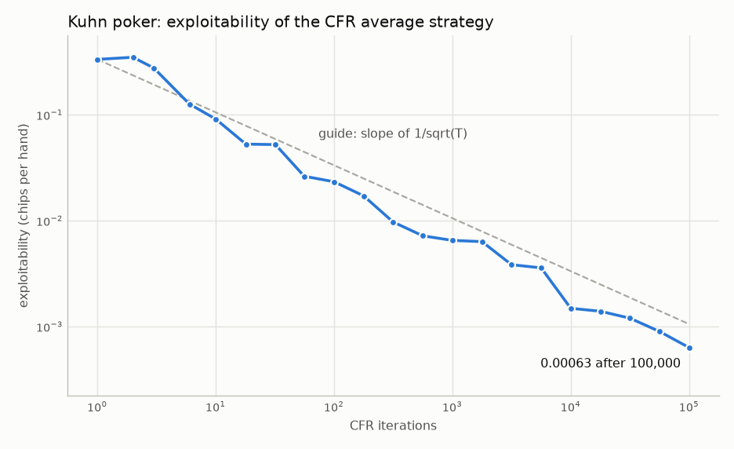
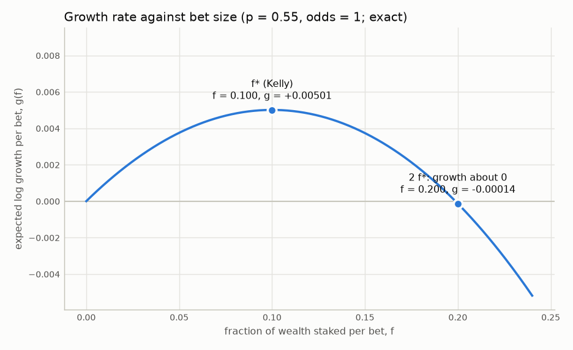

# ev-lab

An offline lab for the mathematics that trading interviews test: probability and expected
value, market making, game theory and bet sizing. Built by Nick, a second-year Economics &
Business Administration student, as a companion to `paper-lab` (a paper-only trading research
lab).

The rule of the project: **compute the answer exactly, then check it with an independent
method**, and never write down a number that a file in this repository did not produce.

## What is in it

| Part | What it does | How it was checked | Result file |
|---|---|---|---|
| Exact probability toolkit and 29 interview puzzles | Answers as fractions, by enumeration, Markov chains and backward induction | Every answer against an independent Monte Carlo simulation: 29 of 29 agree within 4 standard errors | [reports/puzzles/check_all.md](reports/puzzles/check_all.md) |
| Interview trainer | Timed mental math that asks my weak categories more often, a probability quiz, and a "make me a market" game against an informed trader | Question generators against an independent calculation; a stored scripted game | `reports/practice/` (after I practise) |
| Hand evaluation and equity | A fast 7-card evaluator and exact Hold'em equity | A slow obvious evaluator as oracle; the category counts of all 2,598,960 five-card and all 133,784,560 seven-card hands | [reports/cards/cards_check.md](reports/cards/cards_check.md) |
| Game theory | Matrix games by linear programming, regret matching, CFR on Kuhn poker | Exact optimality certificates; game value -1/18; exploitability 0.000633 after 100,000 iterations | [reports/games/games.md](reports/games/games.md) |
| Bet sizing | Kelly criterion, fractional Kelly, drawdowns, estimated edges | Simulation against the exact growth rate; exact binomial sums | [reports/kelly/kelly.md](reports/kelly/kelly.md) |

Poker appears only as a mathematical object. This is offline study: no connection to any
gambling site, no bots, no real-time assistance, no scraping, no credentials. `config.yaml`
carries `offline_only: true` and the loader refuses any other value.

## Three figures

**1. Practice progress.** `uv run ev stats` writes `reports/practice/math_accuracy.png` and
`reports/practice/math_speed.png` from my answer logs. There is no figure here yet because no
practice session has been logged; it will show my real numbers, bad days included.

**2. A solver converging on a poker equilibrium.** Exploitability (how much a perfect
opponent could win) of the CFR strategy for Kuhn poker, on log-log axes.
Source: [reports/games/games.md](reports/games/games.md).



**3. Why bet size matters more than edge.** Expected log growth against the fraction of
wealth staked, for a bet won with probability 0.55 at even money. The Kelly fraction is
1/10; at twice that, growth is about zero.
Source: [reports/kelly/kelly.md](reports/kelly/kelly.md).



## Findings worth a conversation

- **Exact and simulated answers agree on all 29 puzzles** (200,000 trials each, largest
  |z| 3.86, tolerance 4). The outlier was investigated instead of re-seeded; see
  [docs/decisions.md](docs/decisions.md), D-046.
  ([reports/puzzles/check_all.md](reports/puzzles/check_all.md))
- **The fast evaluator matches the oracle** on 100,000 random 7-card hands (0 mismatches) and
  reproduces every category count of every 5-card and 7-card hand.
  AhKh against QsQd before the flop has equity 197833/428076 over all 1,712,304 boards.
  ([reports/cards/cards_check.md](reports/cards/cards_check.md))
- **CFR finds the known equilibrium of Kuhn poker**: value for the first player -0.055554
  against the exact -1/18, and the learned strategy is within 0.0030 of the equilibrium
  family. The family itself is proven by the code in exact arithmetic.
  ([reports/games/games.md](reports/games/games.md))
- **Half Kelly keeps 75% of the growth rate** while the simulated chance of ever halving the
  bankroll drops from 47.1% to 12.3%.
  ([reports/kelly/kelly.md](reports/kelly/kelly.md))
- **Sizing full Kelly from an estimated edge loses money with little data**: expected growth
  is negative for n = 10, 20, 50 past bets although the true edge is positive. An edge whose
  confidence interval includes zero deserves a bet of zero. This is the link to `paper-lab`.
  ([reports/kelly/kelly.md](reports/kelly/kelly.md))

Limitations are listed at the top of every report and in [docs/writeup.md](docs/writeup.md).

## Use

```bash
uv sync               # create the environment from the committed lockfile
make check            # ruff, mypy --strict, pytest (fast set)
make check-all        # the same plus slow exhaustive tests (all 7-card hands)
```

Daily practice:

```bash
uv run ev daily       # 10 minutes: mental math, one puzzle, one market game
uv run ev stats       # streak, weakest categories -> reports/practice/
```

Everything else:

```bash
uv run ev puzzle list                 # puzzles and my status (never shows answers)
uv run ev puzzle try rolls_until_six  # statement -> my answer -> solution
uv run ev puzzle check-all            # exact vs Monte Carlo -> reports/puzzles/
uv run ev math --preset sprint        # 80 questions in 8 minutes
uv run ev market --quantity sum3      # one market game
uv run ev equity AhKh QsQd            # exact: all 1,712,304 boards
uv run ev equity AhKh "TT+,AQs+"      # hand against a range
uv run ev pot-odds --pot 150 --call 50 --equity 0.33
uv run ev cards-check --full          # evaluator and equity checks -> reports/cards/
uv run ev games                       # LP, regret matching, Kuhn CFR -> reports/games/
uv run ev indifference --pot 2 --bet 1
uv run ev kelly                       # growth, simulations, estimated edge -> reports/kelly/
uv run ev kelly-bet --p 0.55 --odds 1
```

`ev puzzle try` always asks for an answer before showing a solution, and reports hide the
answer of any puzzle I have not attempted.

## Layout

```
src/ev_lab/
  prob/      exact distributions, Markov chains, optimal stopping, polygon areas, MC checker
  puzzles/   one module per puzzle: statement, exact solver, simulator, explanation
  trainer/   mental math, adaptive weights, quiz, market game, statistics
  cards/     deck, oracle and fast evaluators, equity, ranges, pot odds
  games/     matrix games (LP), regret matching, Kuhn poker, CFR, indifference
  kelly/     Kelly fraction, path simulation, estimated edge
  reports/   report generators (markdown and PNG)
tests/       one test module per area; tests/expected/ holds stored report outputs
practice/    my answer logs (append-only CSV)
reports/     generated reports and figures
docs/        writeup.md, interview_prep.md, concepts.md, decisions.md, sources.md
```

## Conventions

- Config validated by pydantic (`extra="forbid"`, frozen). Every report carries a run id, the
  git commit, the config hash and the seed.
- Exact arithmetic passes one gate (`prob/exact.py`) that refuses floats.
- Randomness only through `numpy.random.Generator` with explicit, named seeds.
- Reference values come from a checked source ([docs/sources.md](docs/sources.md)) or from a
  second computation, never from memory.
